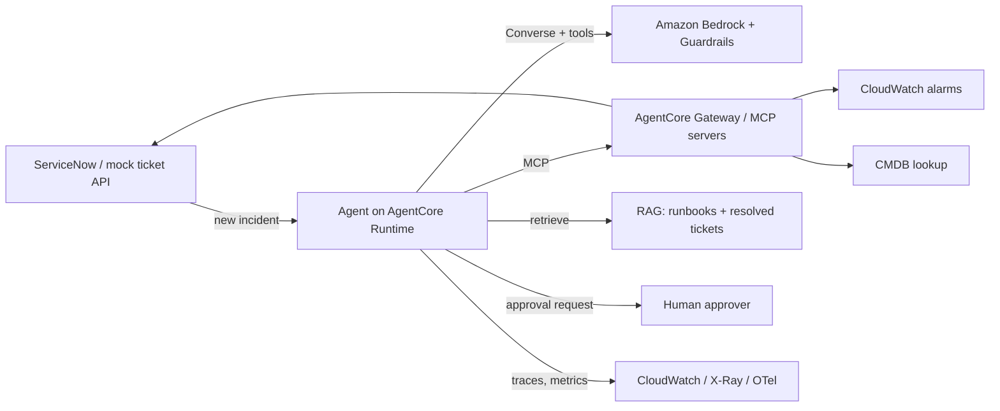

# Capstone Architecture

> Update this at the end of every stage. Keep a diagram (Mermaid below, or draw.io/Excalidraw export) and a short decision log.

## Decision log
| Date | Decision | Options considered | Why |
|---|---|---|---|
| | | | |
